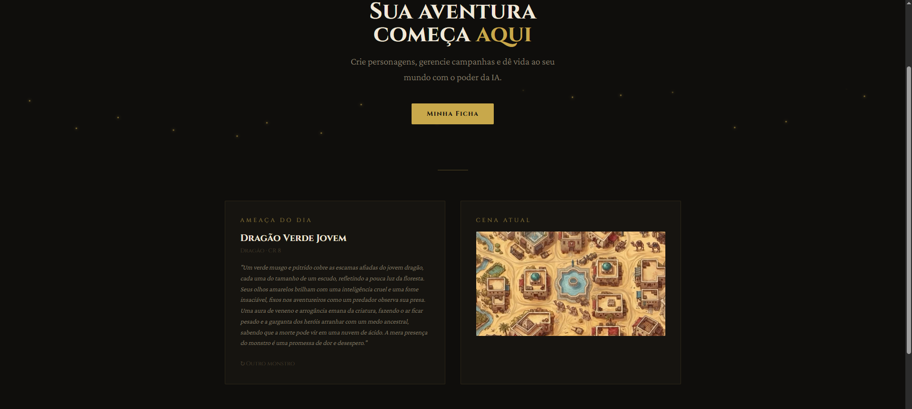
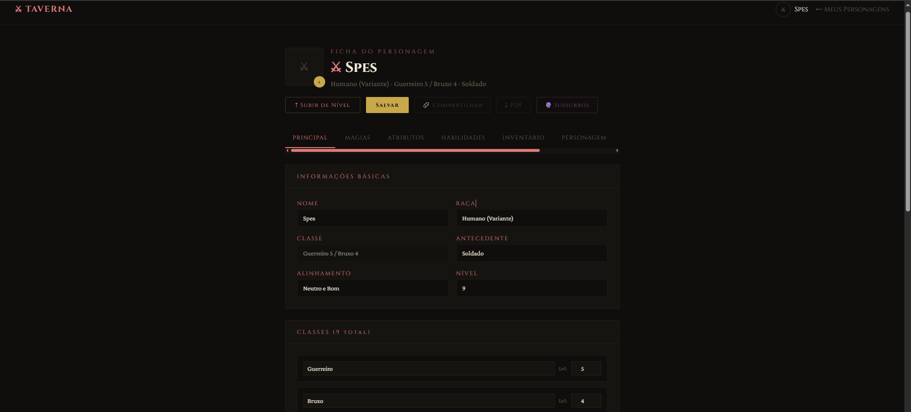
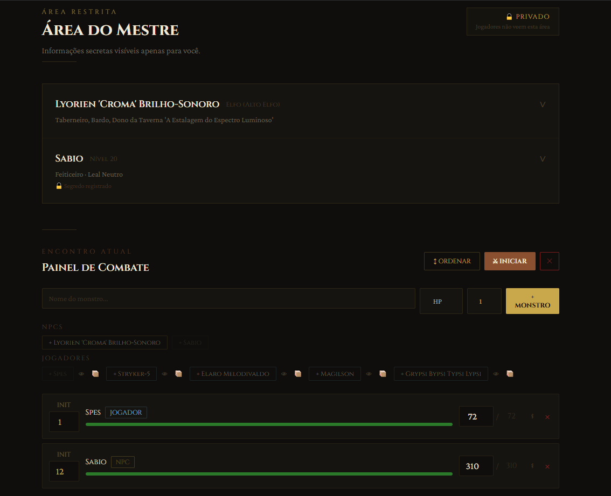
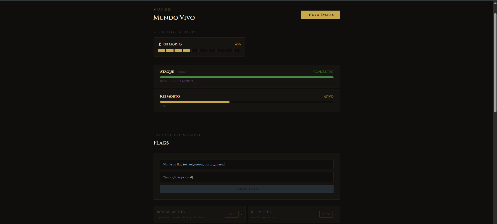
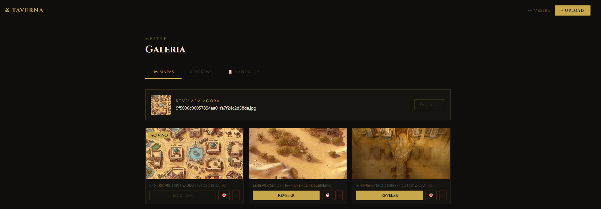

# ⚔ Taverna RPG


Plataforma web fullstack para mesas de RPG presencial com IA generativa, fichas interativas, battle map com tokens, painel do mestre e um "Mundo Vivo" em que eventos, facções e reputações mudam o estado da campanha.

🔗 **[taverna-frontend.vercel.app](https://taverna-frontend.vercel.app)** · Backend: [taverna-backend](https://github.com/Viinicius20/taverna-backend)

---

## 📸 Screenshots

| Home | Ficha |
|------|-------|
|  |  |

| Mestre | Mundo Vivo |
|--------|------------|
|  |  |



---

## ✨ Funcionalidades

### 🎲 Jogador
- Criação de personagem via IA (descrição em linguagem natural) ou importação de PDF
- Ficha interativa completa: atributos, combate, magias, inventário, condições, recursos e descanso
- **Crônica do personagem:** momentos marcantes e marcas permanentes, com emoji por tipo
- Ataques salvos com rolagem de dado integrada e notas privadas por personagem
- Exportação da ficha em PDF e link público de leitura (sem login)
- Level up com IA e seleção de arquétipo por classe
- Documentos (cartas, convites, contratos) recebidos do mestre
- Notificações push de sussurros do mestre (funciona com o app minimizado)

### 🧙 Mestre
- **Painel em abas** (Painel e NPCs), com anotações da sessão em formato de post-it e prazo contado em sessões
- **NPCs:** geração por IA ou PDF, estado emocional, relação com os jogadores (−100 a +100, com histórico de motivos), memória e "Sugerir Reação", que usa humor, relação e memória
- **Combate:** iniciativa, HP, condições, e envio de monstros do bestiário com quantidade e iniciativa rolada
- **Bestiário** com 60+ monstros canônicos de D&D 5e e geração por IA
- **Mundo Vivo:** eventos com progresso, flags, reputação de facções por pontos com histórico de motivos, aviso "o mundo está prestes a mudar" e mistérios abertos ligados a NPCs e cidades
- **Handouts por IA** (carta, bilhete, pergaminho, mapa de tesouro, convite, ameaça, contrato, ordem de facção), com remetente e envio para personagens específicos ou todos
- Battle map com tokens arrastáveis, rotação e escala; galeria de mapas revelados aos jogadores
- **Modo TV (`/tv`):** mapa revelado e ordem de iniciativa para projetar na mesa, sem informação secreta
- Gerador de loot, encontros aleatórios, nomes, calculadora de XP, relógio de pressão e histórico de sessões
- Boatos da taverna gerados a partir do estado da campanha, sem repetir os recentes

### 🌐 Geral
- Login leve por apelido para jogadores; o mestre entra com senha
- Quadro de rumores, PWA instalável e sistema de campanhas com código de convite

---

## 🔐 Acesso e permissões

- Jogadores entram só com o apelido. O perfil do mestre exige senha (hash com bcrypt) e recebe um token JWT.
- As rotas do mestre exigem o papel de mestre no backend. Ficha, diário e documentos de um personagem só abrem para o dono ou para o mestre.
- O login tem limite de tentativas, e a geração por IA tem limites de uso para proteger a cota da API.
- O token é enviado em toda requisição por um interceptor, e uma resposta 401 encerra a sessão.

---

## 🛠 Stack

| Camada | Tecnologia |
|--------|-----------|
| Frontend | React, Tailwind CSS |
| Backend | FastAPI (Python) |
| Banco de dados | Supabase (PostgreSQL) |
| Storage | Supabase Storage |
| IA | Google Gemini 2.5 Flash |
| Notificações | Web Push API (VAPID) |
| Testes e CI | Jest, pytest, GitHub Actions |
| Deploy | Vercel (frontend) e Render (backend) |

---

## 🗄 Estrutura do Banco

```
characters         — fichas dos personagens (JSONB)
profiles           — usuários (apelido, papel e hash de senha do mestre)
campaigns          — campanhas
campaign_members   — membros por campanha
npcs               — NPCs (dados, notas, relação com os jogadores)
factions           — facções e reputação por pontos
reputation_log     — histórico de reputação, com motivo
world_events       — eventos do Mundo Vivo
campaign_flags     — flags de estado do mundo
mysteries          — mistérios abertos, ligados a NPC e cidade
locations          — cidades e locais
session_notes      — anotações da sessão do mestre
sessions           — histórico de sessões
magic_items        — almanaque de itens mágicos
bestiary           — bestiário de monstros
map_tokens         — tokens posicionados no battle map
gallery            — mapas, tokens e handouts
handout_recipients — destinatários de cada handout
secret_messages    — mensagens secretas por personagem
rumors             — quadro de rumores
push_subscriptions — assinaturas de notificação por dispositivo
```

---

## 🧪 Testes

```bash
npm test
```

A rolagem de dados tem testes unitários (Jest), e o CI roda os testes e o build de produção a cada push. O backend tem testes de regras de reputação e de proteção das rotas.

---

## 🚀 Rodando Localmente

```bash
# Instalar dependências
npm install

# Iniciar em desenvolvimento
npm start

# Build de produção
npm run build
```

---

## ⚙ Variáveis de Ambiente

```env
REACT_APP_API_URL=http://localhost:8000
```

Sem a variável, o app usa o backend de produção.

---

## 📁 Estrutura do Projeto

```
src/
├── components/       # Componentes reutilizáveis (reputação, handouts, notas da sessão)
├── constants/        # Valores fixos (tipos de documento)
├── context/          # UserContext (sessão e token)
├── pages/            # Home, Login, Personagens, Ficha, Mestre, Bestiário,
│                     # Galeria, Mundo Vivo, Mistérios, TV, Quadro, Histórico...
├── services/         # Cliente da API e armazenamento do token
└── utils/            # Lógica pura com testes (rolagem de dados)
```

---

## ⚠ Decisões e limitações

- **Login leve de propósito:** o público é uma mesa pequena, e jogadores entram só com o apelido para não ter atrito. A senha protege o papel de mestre.
- **IA por API:** o Gemini recebe contexto montado a partir do banco (memória dos NPCs, estado do mundo, humor). Não há embeddings nem busca vetorial.
- **Atualização por consulta periódica**, e não por conexão em tempo real, na TV e nos documentos.
- **O backend gratuito hiberna:** a primeira requisição depois de um tempo parado pode demorar.

---

## 🔗 Repositório do Backend

[github.com/Viinicius20/taverna-backend](https://github.com/Viinicius20/taverna-backend)